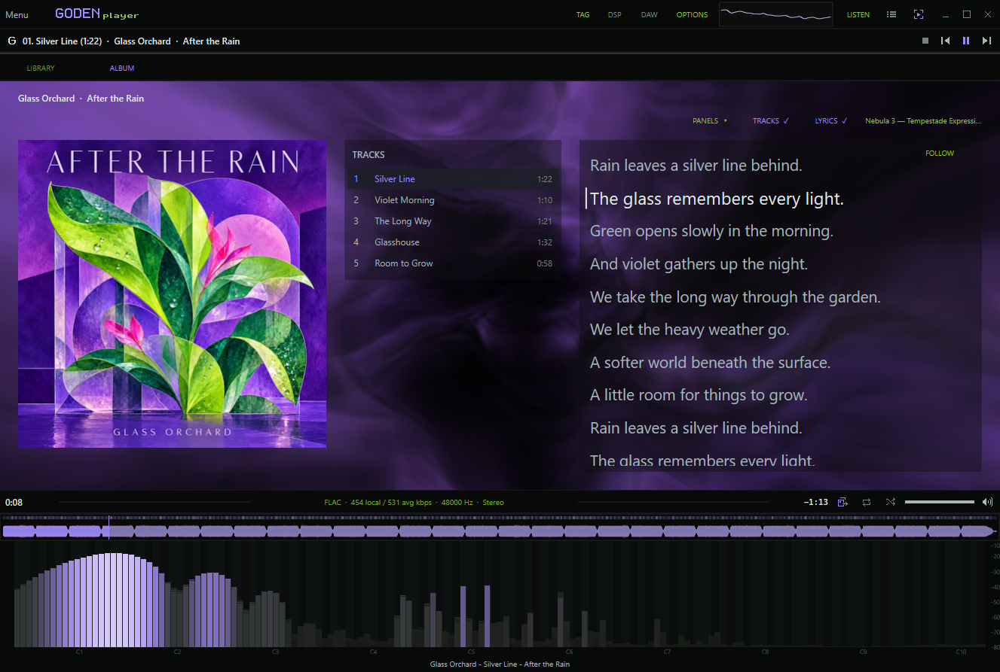
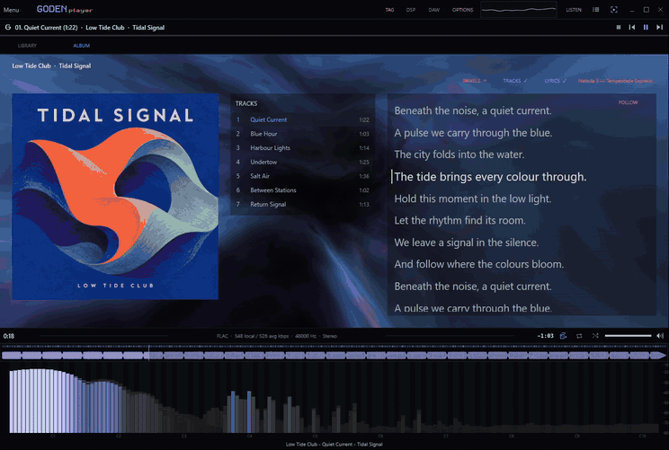
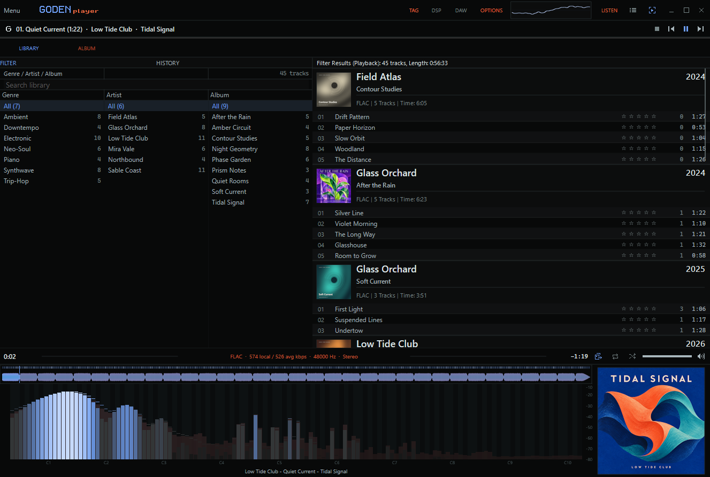

  

<h1 align="center">GODENplayer</h1>

  A native Windows music player built on foobar2000.

<h2 align="center">
  <a href="https://github.com/Godielvs/GODENplayer/releases/latest/download/GODENplayer-Beta-Setup-x64.exe">⬇ Download for Windows (.exe)</a>
</h2>

  Windows 10 / 11 · 64-bit · Beta 
  Download the installer and run it — no build tools required.

  <a href="docs/INSTALL.md">Installation guide</a> ·
  <a href="#demo">Watch the demo</a> ·
  <a href="#features">Features</a> ·
  <a href="docs/BUILD.md">Build from source</a>

## Demo

36 seconds with audio: Library, Album, synchronized lyrics and artwork colours.

https://github.com/user-attachments/assets/98699fd5-5a7b-4ea0-a24e-392e4bdfc621

Animated preview

## Features

### Library & playback

- **Library filters:** search by genre, artist and album, with track counts and album-grouped results.
- **Playback queue, favorites and session history** within the player.
- **Star ratings and play counts**, integrated with optional Playback Statistics.
- **Waveform seeking** to navigate directly to a point in the track.

### Album & visualizers

- **Album view:** cover art, track list and synchronized lyrics, with configurable panels and a theater mode.
- **Artwork colours:** the interface and visuals take their palette from the current cover. **GlyphFlow** animates cover transitions.
- **High-refresh scope and Spectrum:** follow the active display's timing where supported, with additional audio views in **Listen**. Shaders use their own presentation rates.
- **GPU visualizers:** Nebula 3, Clovis, Caustics, Cosmic, Cloud Bay, Radiance Cascades, Spectrogram, Kerr-Newman and more. Selections are saved; Original modes are available where provided.

### DSP, DAW & TAG

| Workspace | What you can do |
| --- | --- |
| **DSP** | Master effects chain with EQ, compression, limiting, stereo processing, saturation, reverb, delay and presets. |
| **DAW** | Sample and stem preview timeline with clip trimming, splitting, and track mute/solo. |
| **TAG** | Batch metadata and artwork editing, with a review before applying changes, backups and undo. |

DAW sessions are temporary and clear on close; project saving and mix export are not supported.

### Discord Presence

Show the current track, progress and cover in Discord. Choose **Catbox**, temporary **Uguu** hosting, **ImgBB** with your own key, a custom relay, catalogue artwork, or text only. New setup offers Automatic: cached covers first, then Uguu, Catbox and catalogue lookup. Only approved services are used; existing choices are preserved. No Discord developer setup is required.

Cover sharing is optional. Public image uploads may persist; Uguu links expire and are renewed during playback. Catalogue mode looks up artwork without uploading your local image. [Privacy settings](docs/PRIVACY.md).

## Installation

Download the [**beta installer**](https://github.com/Godielvs/GODENplayer/releases/latest), choose your music folder and review the optional online features. Setup includes foobar2000 **2.25.10 x64** in a separate application folder; no existing foobar2000 installation or development tools are required.

- **Windows 10 build 19041+ or Windows 11, x64.**
- **Direct3D feature level 11_0** for the full GPU visuals.
- Playback Statistics is an optional download; setup can finish offline without it.

Updates preserve GODEN's profile and preferences. The beta installer is unsigned; verify its supplied SHA-256.

[Installation & recovery](docs/INSTALL.md) · [Compatibility](docs/COMPATIBILITY.md) · [Support](docs/SUPPORT.md)

## Documentation & credits

[Build](docs/BUILD.md) · [Architecture](docs/ARCHITECTURE.md) · [Contributing](CONTRIBUTING.md) · [Changelog](CHANGELOG.md) · [Media credits](docs/MEDIA.md)

GODENplayer is an independent project built on **foobar2000**, **Columns UI** and **Spectrum Analyzer**.

Project code is MIT; third-party components, shaders and assets have separate terms. [License scope](LICENSE-SCOPE.md) · [Third-party credits](docs/THIRD-PARTY.md) · [Shader credits](docs/SHADER-PROVENANCE.md)

## Thanks

Thanks to [catlinman](https://github.com/catlinman) for [NekoRoX](https://github.com/catlinman/foobar2000), the starting point for GODENplayer, and to the CaTRoX contributors behind it.

Thanks to [**Clóvis**](https://github.com/Cloviski) for testing, visual feedback and helping refine the player; to the developers of [foobar2000](https://www.foobar2000.org/), [Columns UI](https://github.com/reupen/columns_ui) and [Spectrum Analyzer](https://github.com/stuerp/foo_vis_spectrum_analyzer); and to the library and shader authors credited above.
